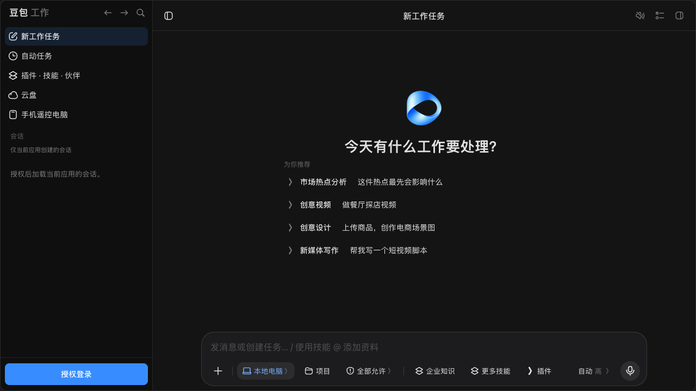
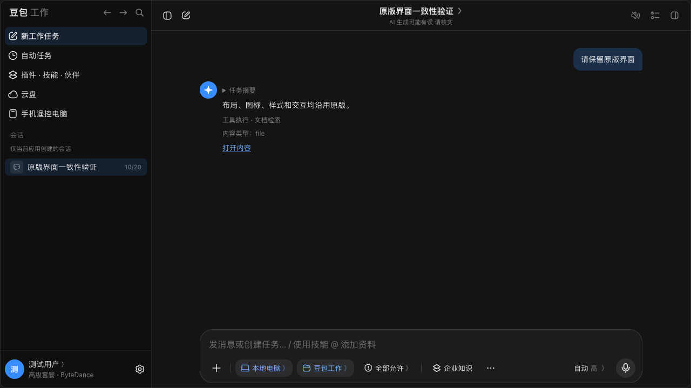

# 豆包 Open API Demo · 妙搭版

保留豆包工作原版界面的妙搭全栈示例，演示如何设计用户授权、管理用户令牌，以及调用豆包 Open API 完成会话与文本对话。

**原版 HTML、DOM、CSS、SVG 和交互完整保留。** React 只负责装载页面；授权、请求与消息接收通过独立适配层连接 NestJS 后端。运行时不依赖 `window.magic` 或飞书文档小组件。



## 可以学习什么

- 用户 OAuth：800 × 600 授权窗口、取消、回调 loading、保存成功后自动关闭。
- 令牌管理：按用户隔离、AES-256-GCM 加密、到期刷新、并发控制和退出。
- Open API：列出与创建会话、详情与消息分页、发送文本、关联助手回复、中断生成。
- 平台适配：保留原版 UI，把请求和授权迁移到自己的后端。
- 交互反馈：加载更多、正在回复、继续接收、侧栏拖拽与折叠。

妙搭业务接口不支持 SSE / WebSocket，此版每约 1.5 秒读取真实消息快照，以 `reply_id` 关联本轮回复；浏览器内适配为原版渲染器可消费的流，**不提供服务端 SSE**。最长约 5 分钟后暂停并保留恢复入口。



## 获取与检查源码

需要 Node.js 20+（实际验证使用 24）和 Bun 1.3.11+。

```bash
git clone https://github.com/vibe-lark/doubao-openapi-miaoda.git
cd doubao-openapi-miaoda
bun install --frozen-lockfile --ignore-scripts
bun run type:check
bun test tests
bun run eslint
bun run build:prod
```

这里使用 `--ignore-scripts`，让尚未绑定妙搭应用的源码仓库不执行平台插件初始化。构建和静态检查不需要真实 OAuth 凭据。运行完整应用需要自己的妙搭 full_stack 应用、平台身份和数据库。部分 SDK 版本在 npm 官方源暂不可用，本仓库通过不含凭据的 .npmrc 使用公开 npmmirror 镜像，并保留已验证的 npm / Bun 锁文件。

## 在自己的妙搭应用中运行

1. 准备一个自己的妙搭 full_stack 应用，用 `lark-cli apps +init` 初始化到**另一个空目录**。
2. 在本仓库执行 `bun run install:demo ../your-miaoda-app`，导入源码。脚本仅接受干净的初始模板，保留目标 `.spark`、环境文件、平台指南及 Git 远端。
3. 按 [妙搭接入与发布指南](docs/MIAODA_SETUP.md) 初始化业务表、生成 schema，配置服务端环境变量和自己的飞书 OAuth 回调。
4. 在目标应用目录运行 `bun install`、`bun run dev:local`，使用终端给出的完整应用路径。

本仓库没有演示应用绑定、凭据、用户数据或原仓库提交历史；不会自动连接作者的线上应用。环境变量模板见 [.env.example](.env.example)，不要用它覆盖平台拉取的 `.env.local`。

## 目录导航

```text
client/src/pages/doubao/
  original/doubao-work-main.html  原版页面完整快照
  originalPage.ts                 仅替换平台桥接入口
  platform.ts                     自有 AppPlatform 与快照接收
  index.tsx                       全视口同源 iframe 宿主
  OAuthCallback.tsx               OAuth 回调页面
client/src/api/doubao/            妙搭 axiosForBackend 请求
server/modules/doubao/            OAuth、令牌管理、Open API 后端
shared/api.interface.ts          前后端类型合同
docs/001-doubao-account.sql       业务表和 RLS 初始化
tests/protocol.test.ts           凭据与内容合同测试
```

- [架构、授权与 Token 处理](docs/ARCHITECTURE.md)
- [妙搭接入、环境配置与发布](docs/MIAODA_SETUP.md)
- [开发与验证边界](docs/DEVELOPMENT.md)
- [原版 UI 验证记录](docs/002-original-ui-validation.json)
- [源码快照来源](SOURCE.json)

## 授权与数据边界

妙搭登录识别“谁在使用这个应用”，豆包 OAuth 识别“该用户是否允许当前飞书应用访问自己的数据”。两层身份分别校验；不是给全团队共用一个 Token。

用户令牌只在后端交换、加密保存和使用。浏览器只获得授权状态与展示资料，不获得 `access_token`、`refresh_token` 或 `APP_SECRET`。数据库以妙搭用户隔离；退出清除此应用保存的本人凭据，不等于退出妙搭或撤销飞书侧所有授权。

业务请求只访问固定的 `open.doubao.com` 接口，禁止把后端改成接受任意 URL 的代理。创建和发送结果不明时，先刷新核对，避免重复任务。

## 已验证与尚未验证

- 三个尺寸（800×600、1440×960、1920×1080）的首页与详情，共六组截图与原版逐像素一致。对比采用相同浏览器、初始偏好和固定测试数据，并通过平台内置个人偏好关闭平台标识。
- 类型检查、静态检查、构建通过；5 项单元测试验证凭据加密及内容合同。
- 原发布应用的授权窗口已实测到达飞书扫码页，取消可恢复。
- 消息快照更新、中断、退出和授权自动关闭竞态使用模拟接口验证。
- **真实用户的授权确认与模型生成尚未实测**；在自己的应用中需要完成真实权限、回调和生成链路验收。

## 学习资料

- [豆包 Open API 接入实践与开发说明](https://www.feishu.cn/docx/Jlk7dIhqPoHRJSxJOhcc5iZrnwc)
- [官方 Open API 调用流程](https://open.larkoffice.com/document/doubao-developer-guide/openapi-call-flow)
- [原版 HTML 源码查看器](https://magic.solutionsuite.cn/html-box/v95MnNLp9IS?id=zz28RvtlLKNcD)

这里只开放示例源代码，平台 SDK 与框架依赖仍按各自的使用条款提供。
