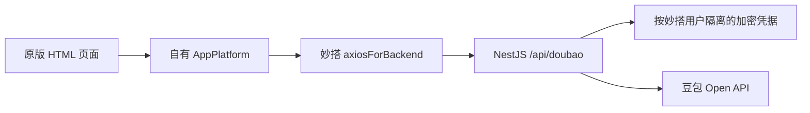

# 架构、授权与 Token 处理

## 请求链

页面使用本仓库的原版 HTML 快照，不嵌入线上妙笔网页。宿主为全视口同源 iframe，隔离平台基础样式。`originalPage.ts` 替换请求、授权和退出的宿主入口，不重写 DOM、CSS、SVG 或界面交互。

`platform.ts` 实现自己的 `AppPlatform`，不是 `window.magic` 的别名：

| 接口 | 作用 |
| --- | --- |
| `request` | 将原版方法、路径和消息合同映射到自己的 BFF |
| `openModal` | 同步打开授权窗口，再发起后端授权并检查本人状态 |
| `getCurrentUserInfo` | 获取当前 OAuth 账号的姓名、头像 |
| `context.environment` | 固定为 `web` 以选择网页布局，不用于鉴权 |
| `store.get/set` | 用本域 localStorage 保存侧栏宽度等 UI 偏好 |
| `logout` | 清除后端保存的本人凭据及待处理授权 |

迁出妙搭时，需要替换 SDK 请求器、平台用户识别和存储；原版界面、桥接合同和豆包业务调用可以继续复用。普通服务器可使用自己的同源 HTTP 客户端与 CSRF 机制；本工程的妙搭前端必须使用 `axiosForBackend`。

## 用户身份与授权

1. Controller 使用 `@NeedLogin()`，从可信的 `req.userContext.userId` 读取妙搭用户，并拒绝匿名和系统身份。
2. `auth/start` 生成 256 位随机 state，数据库只存哈希，10 分钟有效；新尝试使旧尝试失效。
3. 浏览器点击时同步创建 800×600 窗口，防止异步等待后被浏览器拦截，再跳转到真实飞书授权地址。
4. 飞书回调 `/oauth/callback`。回调页清理地址栏参数，通过 `X-Doubao-OAuth-Code` 与 `X-Doubao-OAuth-State` 请求头提交后端，避免把它们写入平台请求体追踪。
5. 后端原子校验用户、state、状态、有效期并认领回调，再交换 token、调用 `user_info` 确认授权账号。
6. 凭据保存成功后才确认授权完成。父窗口轮询自己的授权状态并关闭子窗口；手动关闭、取消、超时会使待处理尝试失效。自动关闭后再核验一次状态，处理迟到的 pending 响应。

前端不通过 postMessage 传递用户令牌，也不把显示姓名或头像当作授权证明。

## Token 生命周期

`doubao-auth.service.ts` 与 `token-crypto.ts` 处理：

- **存储**：access/refresh token、到期时间和 OAuth 账号资料组成凭据，使用 AES-256-GCM 加密；AAD 绑定飞书应用与妙搭用户。
- **隔离**：`doubao_account` 按 owner 存储，数据库 RLS 限制本人行；加密密钥由服务端环境配置保存。
- **调用**：业务请求取得当前用户的凭据，解密后在后端用 Bearer token 调用豆包 API。
- **刷新**：使用 refresh token 更新凭据；数据库租约和版本条件避免多实例并发轮换。刷新结果不明时清除不确定凭据并要求重新授权。
- **退出**：清除此应用保存的本人凭据和待处理 state，不退出妙搭、不替代飞书授权撤销。

不要把 token 放入前端、URL、localStorage、示例文件或日志。平台身份字段只能从可信中间件读取，不能接受请求体里自报的 userId。

## BFF 与官方 API 的区别

上游固定为 `https://open.doubao.com/open-apis/agent/v1`，示例不开放任意 URL 代理。

| 本工程路由（均在 `/api/doubao` 下） | 行为 |
| --- | --- |
| `GET /auth` | 读取本人授权状态与展示资料 |
| `POST /auth/start`、`/complete`、`/cancel`、`/logout` | 授权生命周期 |
| `GET /sessions` | 上游列会话；pageToken 映射为 page_token |
| `POST /sessions` | 用 uuid、name 创建会话 |
| `GET /sessions/:id` | 读取会话详情 |
| `GET /sessions/:id/messages` | 消息分页，校验 order=asc/desc |
| `POST /sessions/:id/events` | 接收 uuid、text，构造原生 user.message 事件 |
| `POST /sessions/:id/interrupt` | 接收 uuid、可选 messageId，向 events 提交 user.interrupt |

`protocol.ts` 将上游 snake_case 映射为共享类型；前端适配回原版页面合同，保留 reply_id、文本、思考摘要、工具名称、链接及内容顺序。

## 回复接收：有界短轮询

妙搭业务接口不承载 SSE / WebSocket。此版提交消息后，每约 1.5 秒读取真实消息快照，按 `sessionId`、`role=assistant` 与 `replyId=本轮用户消息ID` 匹配回复，检查 completed/failed/cancelled。

浏览器内部 `ReadableStream` 将快照交给原版渲染器；它不是服务器事件流，也不模拟模型输出。完整快照替换已有内容，不能把快照当 delta 重复追加。历史按 asc 分页；接收时按 desc 查询。最长约 5 分钟后暂停并保留继续接收入口。

停止会提交 `user.interrupt` 并核对最终消息；关闭本地读取不代表停止服务端生成。`requires_action` 需要用户回原客户端处理工具确认。创建、发送与中断保留操作 UUID；结果不明时先刷新核对，不自动重放写请求。

会话改名、删除、单消息查询和文件上传尚未接入当前 BFF；其他展示入口不代表对应业务已开放。
